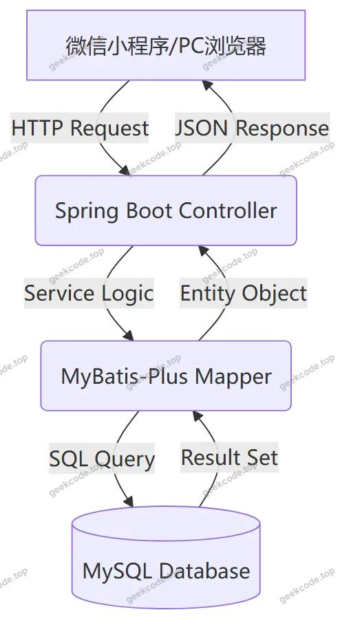
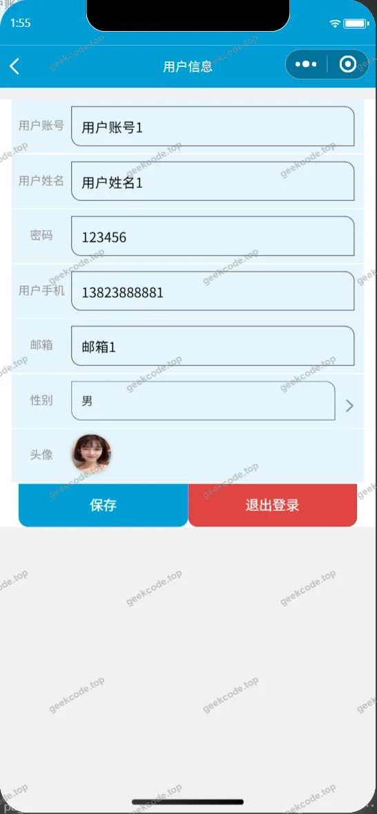
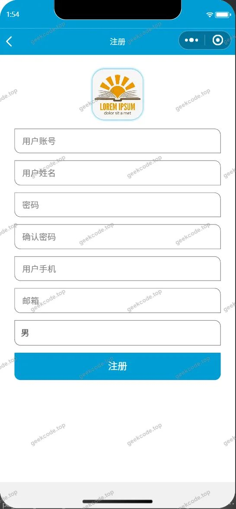
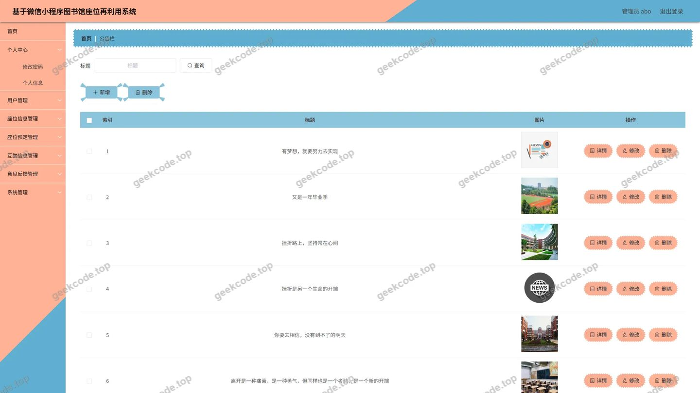
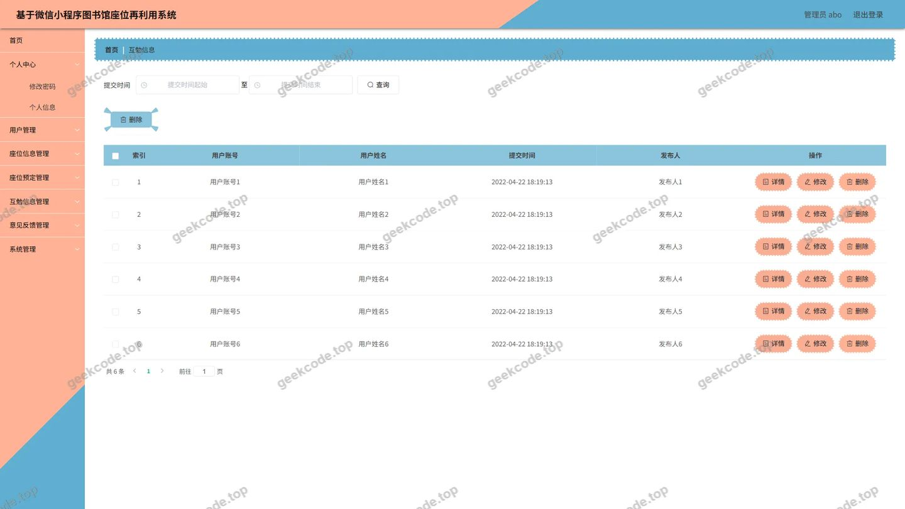
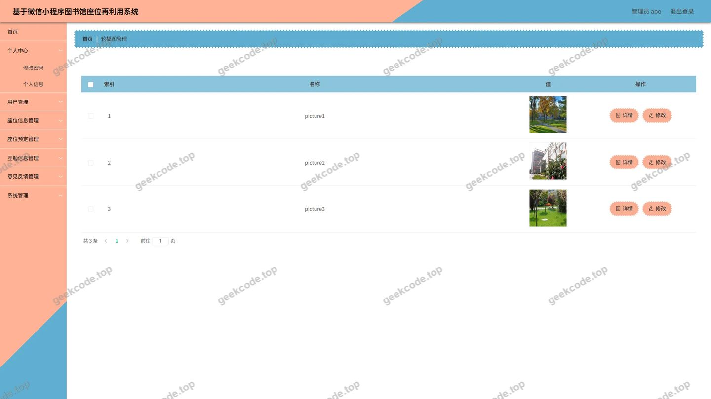
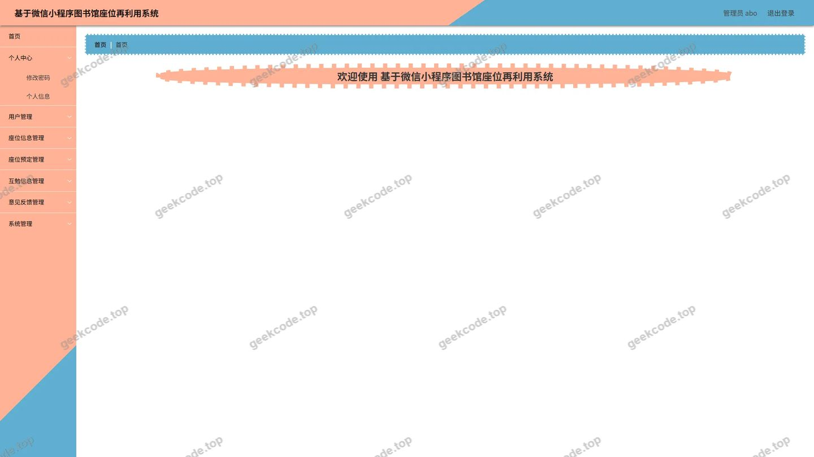
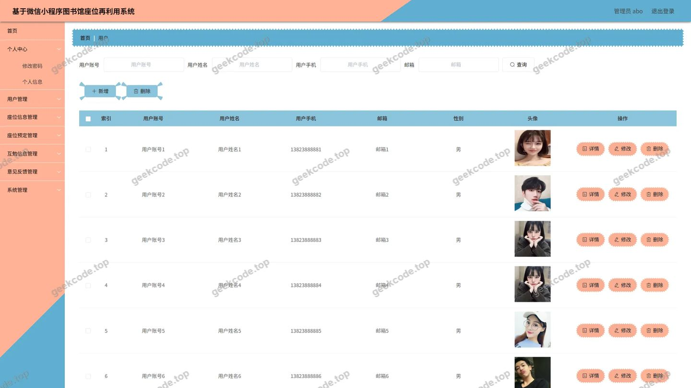
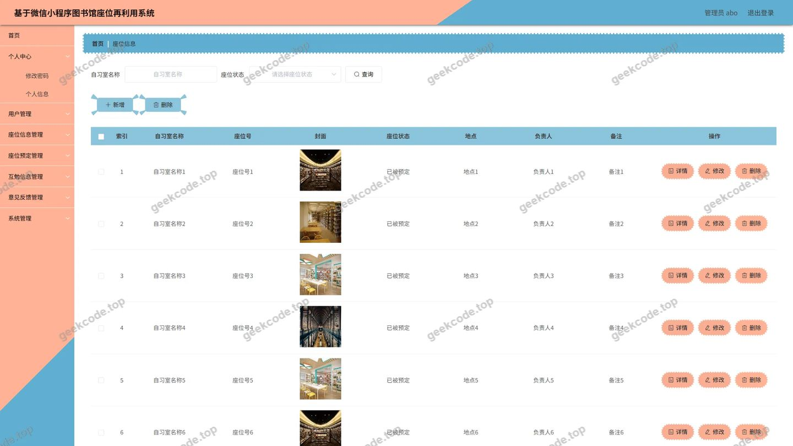
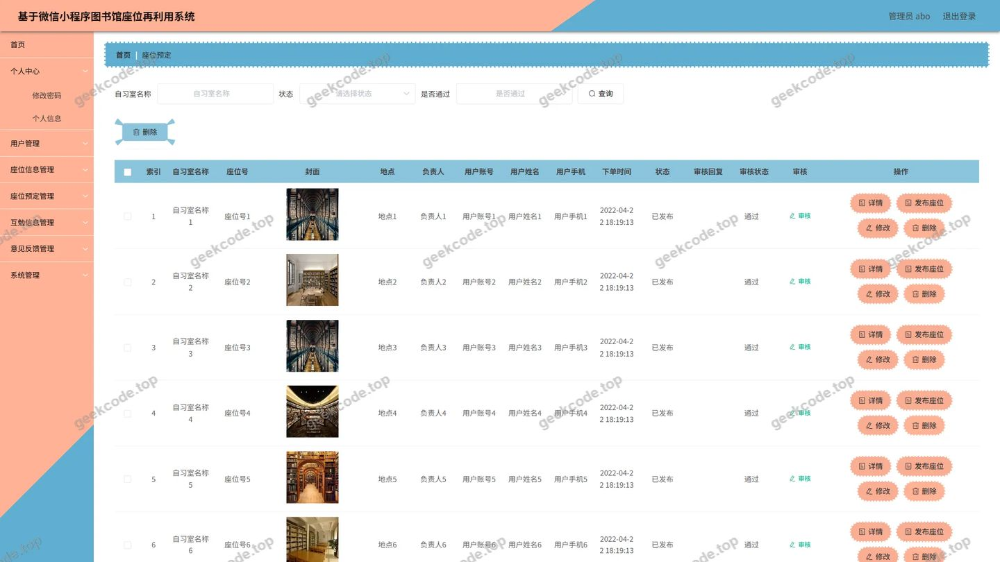

# 基于微信小程序图书馆座位再利用系统

> 🎓 **计算机毕业设计 · 基于微信小程序图书馆座位再利用系统**
>
> 本仓库只放**项目介绍 + 运行截图**（截图是站点带水印的原图，存在仓库 `images/` 里）。
>
> 👉 **完整可运行源码 / 数据库脚本 / 部署文档：[点我获取](https://geekcode.top/archives/%E5%9F%BA%E4%BA%8E%E5%BE%AE%E4%BF%A1%E5%B0%8F%E7%A8%8B%E5%BA%8F%E5%9B%BE%E4%B9%A6%E9%A6%86%E5%BA%A7%E4%BD%8D%E5%86%8D%E5%88%A9%E7%94%A8%E7%B3%BB%E7%BB%9F?utm_source=github)**
>
> 💬 咨询微信：**ir9372**　|　🌐 更多项目：[极客代码 geekcode.top](https://geekcode.top/?utm_source=github)
>
> 📌 项目详情页：<https://geekcode.top/archives/%E5%9F%BA%E4%BA%8E%E5%BE%AE%E4%BF%A1%E5%B0%8F%E7%A8%8B%E5%BA%8F%E5%9B%BE%E4%B9%A6%E9%A6%86%E5%BA%A7%E4%BD%8D%E5%86%8D%E5%88%A9%E7%94%A8%E7%B3%BB%E7%BB%9F?utm_source=github>

<table><td width="230" align="center"> <b>扫码加微信 ir9372</b></td><td valign="middle">📦 源码 = 项目介绍 + 全部运行截图 + 数据库 + 部署文档 👉 点上方任意截图，直接跳到 <b>极客代码 geekcode.top</b> 详情页</td></table>

---

<h1>基于微信小程序图书馆座位再利用系统</h1>
<h2>项目概述</h2>

本项目旨在构建一个基于微信小程序的图书馆座位再利用系统，以解决高校图书馆座位资源紧张、管理效率低下及“占座”现象频发的问题。系统采用前后端分离架构，前端依托微信小程序实现用户端的便捷访问与交互，后端基于 Java Spring Boot 框架提供稳定的业务逻辑处理与数据持久化服务。核心功能涵盖座位信息展示、在线预定、互勉信息发布、意见反馈以及后台的全面管理。适用人群主要为高校学生（普通用户）和图书馆管理人员（管理员）。通过数字化手段优化座位分配流程，提升资源利用率，同时为师生提供透明的互动平台，实现图书馆座位管理的智能化与规范化。

<h2>技术架构</h2>
<h3>1. 总体架构设计</h3>

系统采用 B/S 架构结合移动端小程序模式，分为表现层、业务逻辑层和数据访问层。

<ul>
<li><strong>表现层</strong>：由微信小程序（用户端与管理端入口）和 Vue 集成后台管理系统组成。小程序负责面向学生的轻量化交互，Vue 后台负责复杂的管理操作。</li>
<li><strong>业务逻辑层</strong>：基于 Spring Boot 框架，利用其自动配置特性快速搭建 RESTful API 接口，处理用户认证、座位调度、数据校验等核心业务。</li>
<li><strong>数据访问层</strong>：使用 MyBatis-Plus 作为 ORM 框架，简化 SQL 编写与数据库交互；采用 Druid 连接池进行数据库连接管理与监控，确保高并发下的数据读写稳定性。</li>
</ul>
<h3>2. 核心技术选型理由</h3>
<ul>
<li><strong>Spring Boot + MyBatis-Plus</strong>：Spring Boot 提供了开箱即用的微服务基础能力，降低配置复杂度；MyBatis-Plus 在保留 MyBatis 灵活性的基础上，提供了强大的 CRUD 功能和代码生成器，显著提升开发效率。</li>
<li><strong>Druid</strong>：阿里巴巴开源的高性能 JDBC 连接池，具备完善的监控统计功能，有助于排查数据库性能瓶颈，保障系统数据安全。</li>
<li><strong>微信小程序</strong>：无需安装即可使用，依托微信生态拥有庞大的用户基数，便于推广和使用，特别适合校园场景下的轻量级应用需求。</li>
</ul>
<h3>3. 数据流向示意</h3>

<h2>功能模块</h2>

根据源码控制器列表及截图功能分析，系统主要划分为以下功能模块：

<h3>1. 前台用户端（微信小程序）</h3>
<ul>
<li><strong>用户认证模块</strong>：支持用户注册、登录、忘记密码重置及个人信息维护。</li>
<li><strong>座位信息管理模块</strong>：</li>
<li><strong>座位列表</strong>：展示图书馆各区域座位的基本信息（如位置、状态）。</li>
<li><strong>座位详情</strong>：查看特定座位的详细属性及当前占用情况。</li>
<li><strong>座位预定模块</strong>：</li>
<li><strong>预定列表</strong>：用户查看自己发起的座位预定记录。</li>
<li><strong>预定详情</strong>：查看具体预定的时间、状态及关联座位信息。</li>
<li><strong>互勉信息模块</strong>：</li>
<li><strong>互勉列表</strong>：浏览其他用户发布的寻找学习伙伴或互助信息。</li>
<li><strong>互勉详情</strong>：查看具体互勉内容的详细描述及发布者信息。</li>
<li><strong>意见反馈模块</strong>：</li>
<li><strong>反馈列表</strong>：用户提交对图书馆服务或系统的建议与投诉。</li>
<li><strong>反馈详情</strong>：查看已提交反馈的处理进度及管理员回复。</li>
<li><strong>公告栏模块</strong>：接收并阅读图书馆发布的最新通知与新闻。</li>
</ul>
<h3>2. 后台管理端（Web Admin）</h3>
<ul>
<li><strong>系统配置模块</strong>：管理网站基本参数及文件上传配置。</li>
<li><strong>用户管理模块</strong>：查看所有注册用户信息，执行增删改查操作。</li>
<li><strong>座位信息管理模块</strong>：录入、编辑、删除图书馆座位的物理信息与状态标记。</li>
<li><strong>座位预定管理模块</strong>：审核、查询所有用户的座位预定记录，处理异常预定。</li>
<li><strong>互勉信息管理模块</strong>：发布、编辑或删除互勉信息，维护社区内容健康。</li>
<li><strong>新闻公告管理模块</strong>：发布图书馆新闻、规章制度等公告信息。</li>
<li><strong>意见反馈管理模块</strong>：查看用户提交的反馈，并进行回复或处理标记。</li>
</ul>
<h2>用户角色与权限</h2>

系统主要包含两类角色：<strong>普通用户（学生）</strong> 和 <strong>管理员</strong>。

<h3>1. 普通用户（学生）</h3>
<ul>
<li><strong>访问渠道</strong>：微信小程序。</li>
<li><strong>功能权限</strong>：</li>
<li><strong>个人中心</strong>：修改头像、昵称、密码等个人信息。</li>
<li><strong>座位服务</strong>：浏览座位信息，发起座位预定申请，查看自己的预定历史。</li>
<li><strong>社区互动</strong>：浏览互勉信息列表及详情。</li>
<li><strong>消息获取</strong>：查看新闻公告栏内容。</li>
<li><strong>反馈机制</strong>：提交意见反馈，查看反馈详情及处理结果。</li>
<li><strong>限制</strong>：无法进入后台管理系统，无法修改他人数据，无法发布官方公告。</li>
</ul>
<h3>2. 管理员</h3>
<ul>
<li><strong>访问渠道</strong>：Web 后台管理系统（admin路由），部分管理功能亦可通过小程序管理端入口访问（依据截图“小程序-管理端”存在推断）。</li>
<li><strong>功能权限</strong>：</li>
<li><strong>全局配置</strong>：管理系统配置文件，控制前端显示参数。</li>
<li><strong>用户管理</strong>：对系统内所有用户账号进行生命周期管理（创建、禁用、删除、信息修正）。</li>
<li><strong>资源管理</strong>：全面掌控座位信息的录入与维护，管理所有座位预定记录的审批与状态更新。</li>
<li><strong>内容管理</strong>：发布和管理新闻公告，审核与管理互勉信息，确保内容合规。</li>
<li><strong>反馈处理</strong>：查阅所有用户反馈，进行回复与闭环处理。</li>
<li><strong>数据统计</strong>：通过首页仪表盘概览系统运行状态（基于后台首页截图推断）。</li>
</ul>
<h2>项目特色与创新点</h2>
<ol>
<li><strong>“再利用”理念驱动的资源优化</strong>：项目名称强调“座位再利用”，系统设计侧重于通过预定与互勉机制，提高座位周转率，减少无效占座行为，体现了绿色共享的图书馆管理理念。</li>
<li><strong>双端协同的管理体验</strong>：结合了微信小程序的便携性与 Web 后台的强大管理能力。学生可在移动端随时随地完成预定与查看，管理员则在 PC 端进行高效的数据批量处理，实现了场景化的最佳用户体验。</li>
<li><strong>社交属性的引入</strong>：在传统座位管理基础上增加了“互勉信息”模块，将单纯的物理空间管理延伸至学习社群建设，促进了学生之间的学术交流与合作，提升了系统的粘性与活跃度。</li>
<li><strong>闭环反馈机制</strong>：内置完整的“意见反馈”流程，从提交到详情查看再到后台处理，形成了服务质量监控的闭环，有助于图书馆持续改进服务水平。</li>
</ol>
<h2>部署环境</h2>

为确保系统正常运行，需准备以下软硬件环境：

<table>
<thead>
<tr>
<th align="left">组件类别</th>
<th align="left">软件名称</th>
<th align="left">版本要求</th>
<th align="left">说明</th>
</tr>
</thead>
<tbody><tr>
<td align="left"><strong>开发语言</strong></td>
<td align="left">JDK</td>
<td align="left">1.8+</td>
<td align="left">Java 运行环境，支撑 Spring Boot 后端</td>
</tr>
<tr>
<td align="left"><strong>数据库</strong></td>
<td align="left">MySQL</td>
<td align="left">5.7+ / 8.0</td>
<td align="left">数据存储引擎，建议使用 UTF-8MB4 编码</td>
</tr>
<tr>
<td align="left"><strong>构建工具</strong></td>
<td align="left">Maven</td>
<td align="left">3.6+</td>
<td align="left">依赖管理与项目构建</td>
</tr>
<tr>
<td align="left"><strong>前端环境</strong></td>
<td align="left">Node.js</td>
<td align="left">12+</td>
<td align="left">用于编译 Vue 前端及小程序相关脚本</td>
</tr>
<tr>
<td align="left"><strong>Web服务器</strong></td>
<td align="left">Nginx/Tomcat</td>
<td align="left">-</td>
<td align="left">Tomcat 内置于 Spring Boot Jar 包中；Nginx 可用于反向代理静态资源</td>
</tr>
<tr>
<td align="left"><strong>客户端工具</strong></td>
<td align="left">微信开发者工具</td>
<td align="left">最新版</td>
<td align="left">用于小程序的开发、调试与预览</td>
</tr>
<tr>
<td align="left"><strong>操作系统</strong></td>
<td align="left">Windows/Linux/macOS</td>
<td align="left">-</td>
<td align="left">服务端推荐 Linux (CentOS/Ubuntu)，开发机不限</td>
</tr>
</tbody></table>

<strong>启动步骤简述：</strong>

<ol>
<li>导入数据库 SQL 文件至 MySQL。</li>
<li>修改 <code>application.yml</code> 中的数据库连接地址、用户名及密码。</li>
<li>使用 Maven 打包后端项目 (<code>mvn clean package</code>)。</li>
<li>运行生成的 JAR 包启动后端服务。</li>
<li>配置微信小程序 AppID 及后端接口域名，上传代码或在开发者工具中预览。</li>
</ol>
<h2>五、技术特性</h2>
<ul>
<li>前后端集成部署，前端资源打包至后端 static 目录</li>
<li>使用 MyBatis-Plus 简化数据访问层开发</li>
</ul>
<h2>六、功能模块截图</h2>
<h3>微信小程序用户端</h3>

<figure><figcaption>小程序-登录</figcaption></figure>
<figure><figcaption>小程序-个人信息</figcaption></figure>
<figure><figcaption>小程序-互勉信息列表</figcaption></figure>
<figure><figcaption>小程序-互勉信息详情</figcaption></figure>
<figure><figcaption>小程序-首页</figcaption></figure>
<figure><figcaption>小程序-忘记密码</figcaption></figure>
<figure><figcaption>小程序-我的</figcaption></figure>
<figure><figcaption>小程序-意见反馈列表</figcaption></figure>
<figure><figcaption>小程序-意见反馈详情</figcaption></figure>
<figure><figcaption>小程序-注册</figcaption></figure>
<figure><figcaption>小程序-座位信息列表</figcaption></figure>
<figure><figcaption>小程序-座位信息详情</figcaption></figure>
<figure><figcaption>小程序-座位预定列表</figcaption></figure>
<figure><figcaption>小程序-座位预定详情</figcaption></figure>

<h3>微信小程序管理端</h3>

<figure><figcaption>小程序-管理端-公告栏列表</figcaption></figure>
<figure><figcaption>小程序-管理端-用户列表</figcaption></figure>
<figure><figcaption>小程序-管理端-用户详情</figcaption></figure>

<h3>后台管理端</h3>
<h4>后台-登录页</h4>

<h4>后台-公告栏</h4>

<h4>后台-互勉信息</h4>

<h4>后台-配置文件</h4>

<h4>后台首页</h4>

<h4>后台-用户</h4>

<h4>后台-座位信息</h4>

<h4>后台-座位预定</h4>

---

## 获取完整源码

| 项目 | 说明 |
| --- | --- |
| 项目名 | 基于微信小程序图书馆座位再利用系统 |
| 运行截图 | 本文 26 张（站点带水印原图，仓库 `images/` 目录） |
| 完整源码 | [https://geekcode.top/archives/%E5%9F%BA%E4%BA%8E%E5%BE%AE%E4%BF%A1%E5%B0%8F%E7%A8%8B%E5%BA%8F%E5%9B%BE%E4%B9%A6%E9%A6%86%E5%BA%A7%E4%BD%8D%E5%86%8D%E5%88%A9%E7%94%A8%E7%B3%BB%E7%BB%9F?utm_source=github](https://geekcode.top/archives/%E5%9F%BA%E4%BA%8E%E5%BE%AE%E4%BF%A1%E5%B0%8F%E7%A8%8B%E5%BA%8F%E5%9B%BE%E4%B9%A6%E9%A6%86%E5%BA%A7%E4%BD%8D%E5%86%8D%E5%88%A9%E7%94%A8%E7%B3%BB%E7%BB%9F?utm_source=github) |
| 咨询微信 | **ir9372**（备注：jingpin-yuanma） |
| 更多项目 | [极客代码 geekcode.top](https://geekcode.top/?utm_source=github) |

> 需要源码、部署、改配置、跑不起来等问题，加微信 ir9372 沟通，说明项目名即可。
